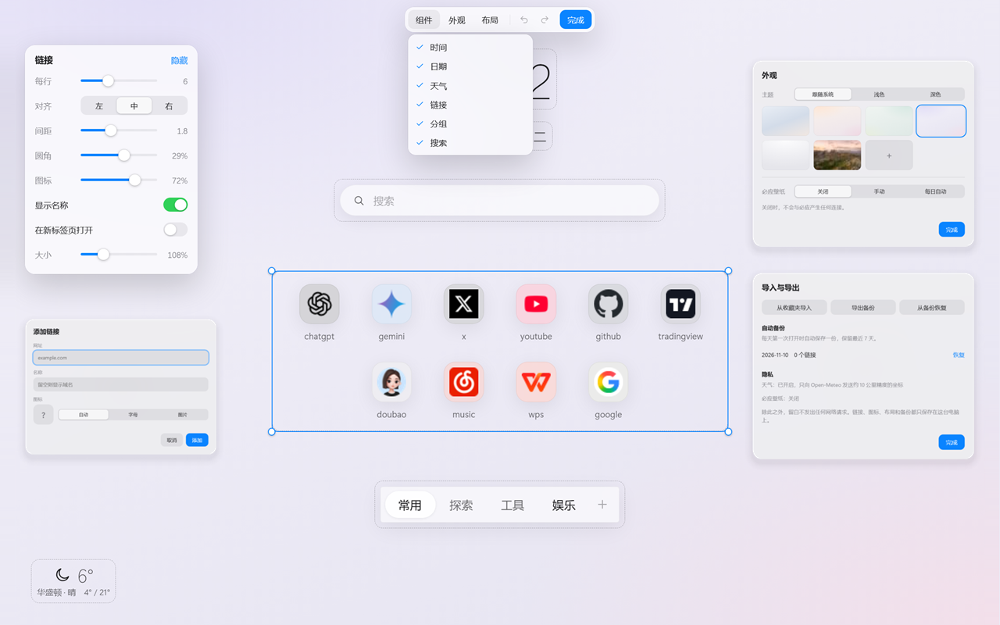

# 留白标签页

极简、本地、私密的浏览器新标签页扩展，适用于 Microsoft Edge 和 Chrome。

[视频教程](https://www.bilibili.com/video/BV1mNWu6PEvJ/?share_source=copy_web&vd_source=891d3d0cfea22ff4b68d6fe8d1bf8acd)

## 特点

- **自由布局**：时间、日期、搜索、天气、链接、分组，每个组件都可以拖动、缩放、显示或隐藏。带吸附、对齐线、撤销，可保存多套布局。
- **默认不联网**：没有账号、统计和后台进程。数据只存在本机。
- **图标**：默认读取本地缓存，支持按需查找高清图标。支持自定义图片、手动文字和自动模式的备用文字。
- **轻**：原生 HTML / CSS / JavaScript，无依赖，无构建步骤。

## 安装

1. 下载本仓库。
2. 打开 `edge://extensions`（Chrome 为 `chrome://extensions`），开启「开发人员模式」。
3. 点击「加载解压缩的扩展」，选择 `liubai` 文件夹。

## 使用

| 操作 | 方法 |
|---|---|
| 打开菜单 | 在空白处点击右键 |
| 调整布局 | 长按空白处，或右键 →「编辑布局」；拖动移动，拖四角缩放，`Esc` 完成 |
| 添加链接 | 右键 →「添加链接」，或从收藏夹导入 |
| 管理链接 | 右键图标可编辑、删除；拖动排序；悬停分组名后继续拖到目标位置 |
| 管理分组 | 双击重命名，拖动排序，方向键和滚轮循环切换。链接区可滚动时优先浏览链接 |
| 页面字色 | 右键 →「外观」→ 页面字色、文字阴影；统一应用于时间、日期、天气和链接名称 |
| 调整链接样式 | 编辑布局 → 选中链接组件 → 图标底色、名称字色、图标占比和排列方式 |
| 固定图标位置 | 编辑布局 → 链接 → 排列方式 → 固定位置。拖动或删除会保留空位，拖到其他图标上可交换位置 |
| 搜索 | 直接打字。先匹配自己的链接，否则使用浏览器的默认搜索引擎 |
| 壁纸与主题 | 右键 →「外观」 |
| 备份与恢复 | 右键 →「导入与导出」。JSON 包含链接、自定义图标和设置，壁纸原图留在当前浏览器 |

## 隐私

留白默认离线。以下功能由你主动开启或点击：

| 功能 | 连接到 | 发送的内容 |
|---|---|---|
| 天气 | `api.open-meteo.com` | 精确到 0.1°（约 10 公里）的坐标。城市到坐标的换算在本地完成 |
| 必应壁纸 | `www.bing.com` | 无。请求不带账号信息 |
| 直接查找高清图标 | 选中的 HTTPS 网站及其声明的图标来源 | 按需请求站点首页和图标资源，不带 Cookie 或来源页面 |
| 通过 Icon Horse 查找 | icon.horse | 仅发送待查网站的域名，服务也会收到请求 IP |

打开留白、添加链接和切换分组时，图标从本地缓存读取。添加或编辑链接时展开「更换图标」可查找单个图标；编辑布局 → 链接 →「图标管理」可批量查找。添加链接窗口也保留批量入口。网络查找需要主动发起，结果保存在本机。

必需权限为 `storage`（保存数据）、`favicon`（读取浏览器本地的网站图标）和 `search`（调用默认搜索引擎）。收藏夹和必应的权限在使用时申请。

## 致谢

天气数据来自 [Open-Meteo](https://open-meteo.com/)。

---

# Liubai New Tab

A minimal, local-first, private new tab extension for Microsoft Edge and Chrome. The interface is in Chinese.

## Features

- **Free layout**: clock, date, search, weather, links and groups can each be moved, resized, shown or hidden, with snapping, alignment guides, undo and saved layouts.
- **Offline by default**: no account, no analytics, no background process. Your data stays on your device.
- **Icons**: use the local browser cache. You can look for better icons on demand, pin an image, or use custom text.
- **Light**: plain HTML / CSS / JavaScript, no dependencies, no build step.

## Install

1. Download this repository.
2. Open `edge://extensions` (or `chrome://extensions`) and turn on Developer mode.
3. Click "Load unpacked" and select the `liubai` folder.

## Usage

| Action | How |
|---|---|
| Open the menu | Right-click an empty area |
| Edit the layout | Long-press an empty area, or right-click → 编辑布局; drag to move, drag a corner to resize, `Esc` to finish |
| Add links | Right-click → 添加链接, or import from bookmarks |
| Manage links | Right-click an icon to edit or delete; drag to reorder, or hover over another group name while dragging to choose a destination there |
| Manage groups | Double-click to rename and drag to reorder. All four arrow keys and the mouse wheel cycle through groups. The link area scrolls its own content first |
| Page text | Right-click → 外观 to choose a shared text color and optional shadow for the clock, date, weather, and link names |
| Style links | Edit the layout and select the links widget to change the icon fill, label color, icon scale, or fixed positions |
| Search | Just type. Your own links match first; otherwise the browser's default search engine is used |
| Wallpaper and theme | Right-click → 外观 |
| Backup and restore | Right-click → 导入与导出. JSON backups include links, custom icons, and settings. The wallpaper image stays in the current browser |

## Privacy

Liubai is offline by default. The following features connect when enabled or used:

| Feature | Connects to | What is sent |
|---|---|---|
| Weather | `api.open-meteo.com` | Coordinates rounded to 0.1° (about 10 km). City lookup happens locally |
| Bing wallpaper | `www.bing.com` | Nothing. Requests carry no account information |
| Find high-resolution icons directly | Linked HTTPS sites and their declared icon hosts | Requests the home page and icon resources without cookies or a referrer |
| Look up icons with Icon Horse | icon.horse | Receives the queried hostname and the request IP |

Adding a link, opening a new tab, and switching groups use local icon caches. Expand 更换图标 in the link editor to find a better icon. For bulk lookup, open 编辑布局 → 链接 → 图标管理, or use the shortcut in the Add Link dialog. Network access starts when requested, and the icons are saved locally.

Required permissions are `storage` (save your data), `favicon` (read the browser's local site icons), and `search` (use the default search engine). Access to bookmarks and Bing is requested when used.

## Credits

Weather data by [Open-Meteo](https://open-meteo.com/).
